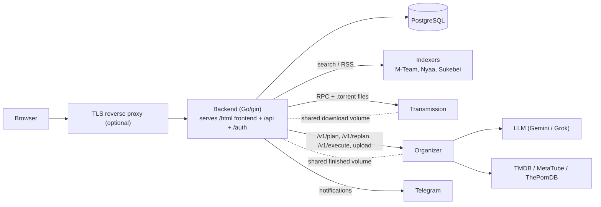

# AutoGet

A comprehensive torrent management system that unifies access to multiple torrent indexers, manages downloads, and integrates with file organization services.

AutoGet consists of a modern web frontend and Go backend service that allows you to search, download, and organize torrents from various indexers (M-Team, Nyaa, Sukebei) through a single interface.

## Features

- **Multi-Indexer Search**: Search across multiple torrent sources with advanced filtering
- **Smart Download Management**: Control Transmission downloads with progress tracking and seeding policies
- **Modern Web Interface**: Responsive frontend built with Lit, TypeScript, and Tailwind CSS
- **Automatic File Organization**: Integrate with organizer service to manage downloaded files
- **RSS Monitoring**: Automated torrent discovery with cron-based scheduling
- **RESTful API**: Complete API for automation and third-party integration

## Architecture

The frontend is a static build served by the backend from `/html`. The backend
copies (or uploads over HTTP) completed downloads to the organizer's input
directory, asks the organizer for a plan, and executes it once you accept it.

## Quick start (Docker Compose)

1. Copy [docker-compose.example.yml](docker-compose.example.yml) to
   `docker-compose.yml` and replace every `CHANGE_ME` placeholder.
2. Copy [backend/example.config.yaml](backend/example.config.yaml) to
   `config/config.yaml` and edit it. The paths in the downloader section must
   match the volumes in the compose file (details are in the compose header).
3. Configure authentication (below), then `docker compose up -d`.

The images are `ghcr.io/autoget-project/autoget` (backend + frontend, runs as
uid 1000, config at `/config/config.yaml`) and
`ghcr.io/autoget-project/autoget-organizer` (configured purely by environment
variables, see the [Organizer README](organizer/README.md)). To build them
yourself run `just build-images`. Go 1.27.4 is used by the Dockerfiles and CI.

## Authentication

The backend requires an `auth` section in its config and refuses to start without one. Configure OIDC login, or explicitly opt out with `auth: {disabled: true}` (the API is then unauthenticated, so only do this behind another access control such as a VPN or an authenticating reverse proxy). See [Backend README](backend/README.md#oauthoidc-login-auth) for provider requirements and the token-storage trade-off.

## Upgrading and database migrations

Schema management is GORM `AutoMigrate` only. It creates missing tables,
columns and indexes, and may alter an existing column's type when its size,
precision or nullability changes in the Go model. It never renames or drops
columns, so any such change would need a manual migration. Back up the
PostgreSQL database before upgrading to a new image version.
There is no versioned migration tooling.

## Details

For detailed setup and API documentation, see:
- [Frontend README](frontend/README.md)
- [Backend README](backend/README.md) (configuration, auth, API)
- [Backend OpenAPI spec](backend/openapi.yaml)
- [Organizer README](organizer/README.md) (environment variables, API)
- [docker-compose.example.yml](docker-compose.example.yml)
